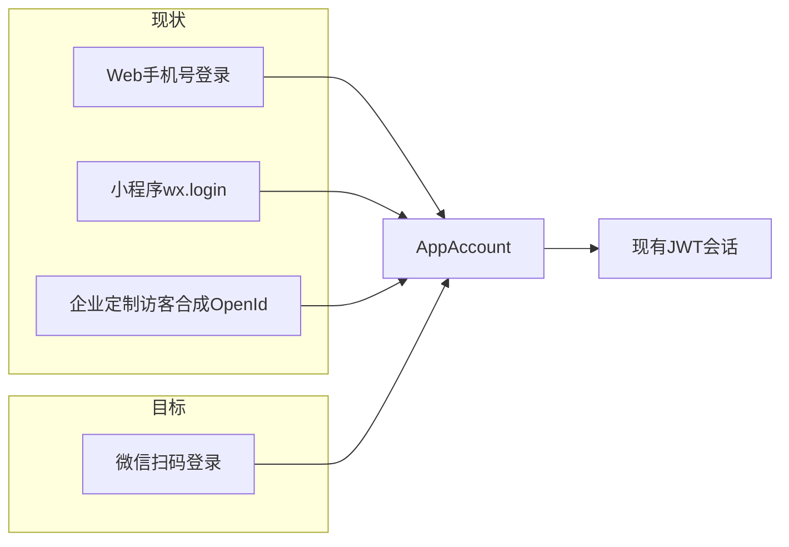
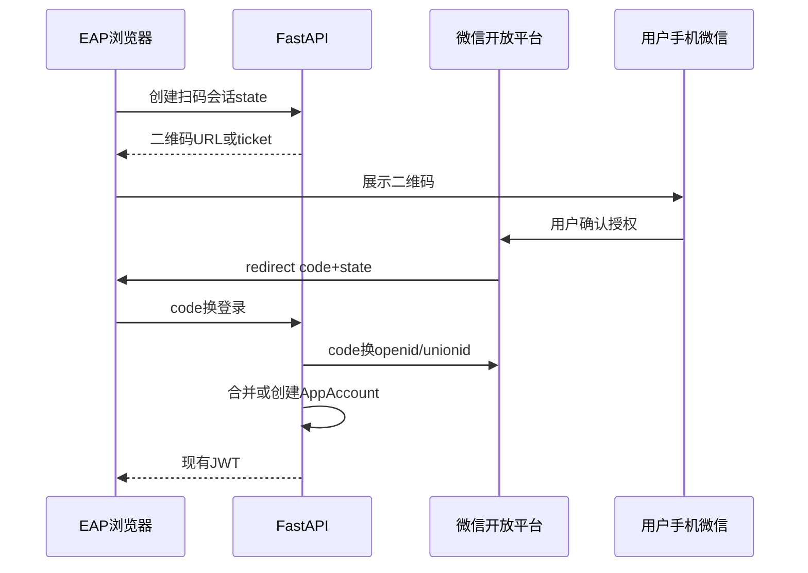

# 定制化 EAP 网页微信扫码登录机制分析

> 性质：机制选型与落地规划（**当前阶段不改代码**）。  
> 范围：`EAP_front_site` 定制化 EAP 网页；与小程序、企业访客账号共用的 `AppAccount` / JWT 体系。

## 1. 现状锚点

| 入口 | 实现位置 | 身份落点 |
|------|----------|----------|
| EAP Web 手机号验证码 / 密码 | `EAP_front_site/src/lib/api/auth.ts` → `/api/web/auth/*`（`backend-python/web_auth.py`） | `AppAccount.Mobile`；`OpenId` 多为 `web_phone_{mobile}` |
| 小程序一键登录 | `wx.login` → `jscode2session`（`backend-python/auth.py`） | `AppAccount.OpenId` = 小程序 openid；可写 `UnionId` |
| 企业定制访客 | `assessment_enterprise_routes._ensure_enterprise_visitor` | 合成 `OpenId`：`eap-ent-{slug}-{digest}`，**非微信身份** |
| 会话 | `AppLoginSession` + `create_access_token` / `_issue_token` | Web / 小程序共用 JWT |

扫码登录本质是：**给 Web 再接一条能拿到稳定微信身份（优先 UnionID）并兑换现有 JWT 的入口**，同时处理好与手机号账号、小程序账号、企业访客账号的合并。

现网已具备：

- `AppAccount.UnionId` 字段（`models.py`）
- 小程序登录的 UnionID 归并逻辑（`auth.py` login：先 openid，再 unionid，再新建）

缺口是：**Web 侧尚无微信扫码 / OAuth 换票入口**；开放平台网站应用凭证与回调域也未接入。

---

## 2. 可选机制对比

### 2.1 微信开放平台「网站应用」扫码登录（推荐主路径）

**是什么**：PC/普通浏览器展示微信二维码，手机微信扫码确认后，网站拿到 `code`，后端换 `access_token` + `openid`，绑定开放平台后还可拿 `unionid`。

**适合**：定制化 EAP 在电脑浏览器打开、员工扫码登录；最符合「扫码登录」字面需求。

**门槛**：

- 微信开放平台账号 +「网站应用」审核 / 备案类要求
- 配置授权回调域
- 要与小程序同一人：小程序、网站应用（及可选公众号）须绑定**同一开放平台账号**，才能统一用 UnionID

**与现网契合度**：高。后端可新增「扫码回调 → 查/建 AppAccount → `_issue_token`」，前端登录页加二维码，不动现有短信登录。

**风险**：审核周期；未绑开放平台时只有各自 OpenID，难与小程序自动合并。

### 2.2 公众号网页授权（OAuth2）——偏「微信内打开」

**是什么**：微信内置浏览器打开 H5，走 `snsapi_base` / `snsapi_userinfo`。

**适合**：链接发到微信群、员工手机微信直接打开 EAP。

**不适合单独当作桌面扫码**：PC 浏览器本身不弹微信二维码；PC 场景仍应回到 2.1，或走关注/带参二维码变体（体验差、运维重）。

**门槛**：认证服务号；JS 安全域名；建议挂开放平台拿 UnionID。

### 2.3 小程序码 / 小程序中转登录（过渡 / 补充）

**是什么**：Web 生成带 `scene/state` 的小程序码 → 用户扫码进已有小程序 → `wx.login` 鉴权后写一次性 ticket → Web 轮询/回跳拿 JWT。

**适合**：

- 已有小程序与账号体系
- 网站应用未获批、想快速上线「扫码即登」
- 希望登录身份与小程序天然一致（同一 OpenID 体系）

**优点**：复用 `auth.py` 的 `jscode2session`；无需先做网站应用。  
**缺点**：依赖小程序；产品上是「扫小程序码」；需设计 ticket 过期、防重放、Web 轮询。

### 2.4 企业微信扫码 / OAuth（企微客户专项）

身份主键是企业微信 `userid`，与个人微信 OpenID / 现有小程序账号不是同一套。适合强制企微生态、要通讯录/部门授权的客户；改造面大。  
现有 `eap-ent-*` 是匿名/员工信息访客链路；若要做「真员工身份」，企微比个人微信扫码更贴组织管控，但不宜与大众微信登录混为一谈。

### 2.5 不推荐作为主方案

| 机制 | 原因 |
|------|------|
| 公众号带参二维码关注登录 | 强依赖关注、运营成本高、体验旧 |
| 仅用微信支付 OpenID 反推登录 | 无支付则无身份；合规与产品都不合适 |
| 第三方聚合登录 | 多一层供应商与合规审查，EAP 敏感数据场景谨慎 |

---

## 3. 账号统一：UnionID / 绑定策略

扫码登录后至少有三种账号可能相遇：

1. 小程序老用户（`OpenId` = 小程序 openid，可能已有 `UnionId`）
2. Web 手机号用户（`OpenId` ≈ `web_phone_{mobile}`，通常无微信身份）
3. 企业定制访客（`OpenId` = `eap-ent-...`）

**原则（分析结论，非本次实现）**：

| 决策 | 建议 |
|------|------|
| 长期主键 | 开放平台 **UnionID**（字段已存在，需在 Web 扫码链路写入）+ 可选手机号 |
| 查找顺序 | 与小程序对齐：网站应用 openid → UnionID 命中旧号 → 再新建；命中后回写缺失的 UnionID / 网站应用 openid（勿覆盖已有 UnionID） |
| 与手机号合并 | 已登录手机号会话下提供「绑定微信」；或扫码后引导绑手机（企业实名场景可强制） |
| 企业专属链接 | 明确二选一语义，**禁止混用同一合成 OpenId**：① 微信登录后进入企业空间；② 继续匿名员工信息访客（现有 `eap-ent-*`） |
| 禁止 | 用 `eap-ent-*` 冒充微信登录身份；未打通 UnionID 时假定「扫码用户 = 小程序用户」 |

存储注意：网站应用 openid 与小程序 openid 不同。若长期要在同一 `AppAccount` 上保留两端 openid，需新增映射字段或侧表（例如 `WebOpenId` / `MpOpenId`），**不要**简单用网站 openid 覆盖小程序 `OpenId`，否则小程序会话会断。短期若只做 Web 扫码且未绑开放平台，可先按独立账号建号，待 UnionID 打通后再合并工具。

---

## 4. 场景拆分：PC vs 微信内

| 入口 | 更合适机制 |
|------|------------|
| 电脑浏览器打开企业 EAP | 网站应用扫码登录 |
| 手机微信内打开链接 | 公众号 OAuth 或直接跳小程序 |
| 只有小程序、暂无开放平台网站应用 | 小程序码中转 |

完整方案通常是 **PC 扫码 + 微信内 OAuth/小程序** 双通道，后端统一发 JWT。

---

## 5. 资质、合规与短信登录关系

- 网站应用 / 服务号需主体资质；EAP/心理类目与隐私政策需合规
- 登录页说明昵称头像用途；能静默/最小字段则不拉 `snsapi_userinfo`
- 扫码登录账号仍按企业 slug / 授权量表做授权，不能「微信登录 = 看全部量表」
- **保留手机号登录**，扫码作为增强：
  - 纯扫码：低摩擦，客服找回较弱
  - 扫码后强制绑手机：更安全、更贴企业实名
  - 定制企业可配置：仅微信 / 微信+员工信息 / 仅员工信息访客

---

## 6. 推荐结论（优先级）

1. **主推**：微信开放平台网站应用扫码登录 + UnionID 账号打通  
2. **过渡/补充**：小程序码中转登录（网站应用未获批时可先上线，复用现有小程序鉴权）  
3. **按需**：公众号 OAuth（微信内 H5）；企业微信（强企微客户）

---

## 7. 后续落地架构示意（仅规划）

### 7.1 未来实现能力清单

**后端（建议挂在 `/api/web/auth` 旁或独立 `wechat_web_auth`）**

- [ ] 开放平台网站应用配置：`WECHAT_OPEN_APPID` / `WECHAT_OPEN_SECRET`、回调域
- [ ] 扫码会话：`state`（防 CSRF）、过期时间、一次性消费
- [ ] `code` → `access_token` / `openid` / `unionid`（开放平台 OAuth）
- [ ] 账号解析：网站 openid / UnionID 查建号；与手机号绑定 API
- [ ] 复用 `_issue_token`（或等价）写入 `AppLoginSession` 并返回现有 JWT
- [ ] 企业 slug 场景：登录后仍走企业授权量表校验，不改变 `eap-ent-*` 语义
- [ ]（过渡）小程序码 ticket：创建 / 小程序确认 / Web 轮询 / 防重放

**前端（`EAP_front_site`）**

- [ ] 登录页「微信扫码」入口与二维码展示（官方嵌入或自建轮询）
- [ ] 回调页：`code`+`state` → 换 JWT → 写入现有 auth store
- [ ] 保留短信 / 密码登录；可选「绑定手机」引导
- [ ] 微信内 UA：降级为公众号 OAuth 或跳小程序，避免硬塞 PC 扫码 UI

**运维 / 产品**

- [ ] 开放平台：网站应用审核；小程序与网站应用绑定同一主体
- [ ] 隐私政策与登录页文案
- [ ] 企业配置项：是否允许微信登录、是否强制绑手机、是否与访客模式并存

### 7.2 现阶段明确不做

- 不用 `eap-ent-*` 合成号冒充微信登录身份
- 不在未打通 UnionID 时假设扫码用户等于小程序用户
- 不只做前端唤起而后端仍只认手机号——会话体系必须显式扩展

---

## 8. 小结

| 机制 | 是否真扫码 | 适配场景 | 与现网契合 | 推荐度 |
|------|------------|----------|------------|--------|
| 开放平台网站应用扫码 | 是 | PC/通用浏览器 EAP | 高 | 主推 |
| 小程序码中转 | 是（小程序码） | 快速上线、复用小程序 | 很高 | 过渡/补充 |
| 公众号 OAuth | 否（微信内授权） | 手机微信打开 H5 | 中 | 微信内补充 |
| 企业微信扫码/OAuth | 是 | 企微组织客户 | 中低（新身份体系） | 专项客户 |

**一句话**：定制化 EAP 网页若要「开放微信扫码登录」，应优先走**微信开放平台网站应用扫码**，并用 **UnionID** 与小程序账号打通；短期可用**小程序码中转**；微信内打开再用公众号授权；纯企微客户另议企业微信方案。本次仅完成机制分析与落地清单落库，**不涉及业务代码改动**。
